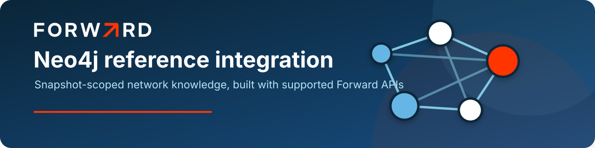
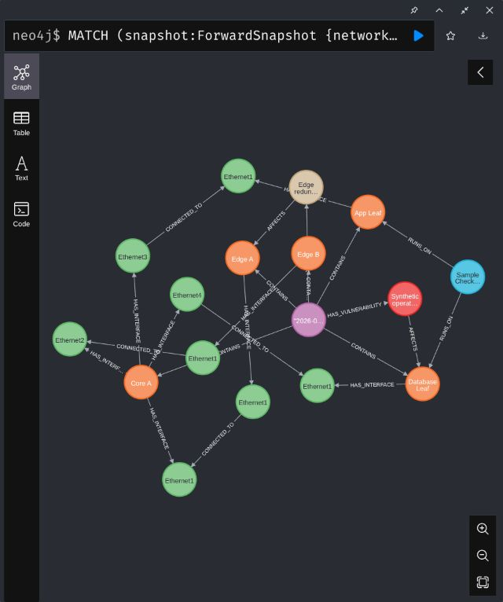
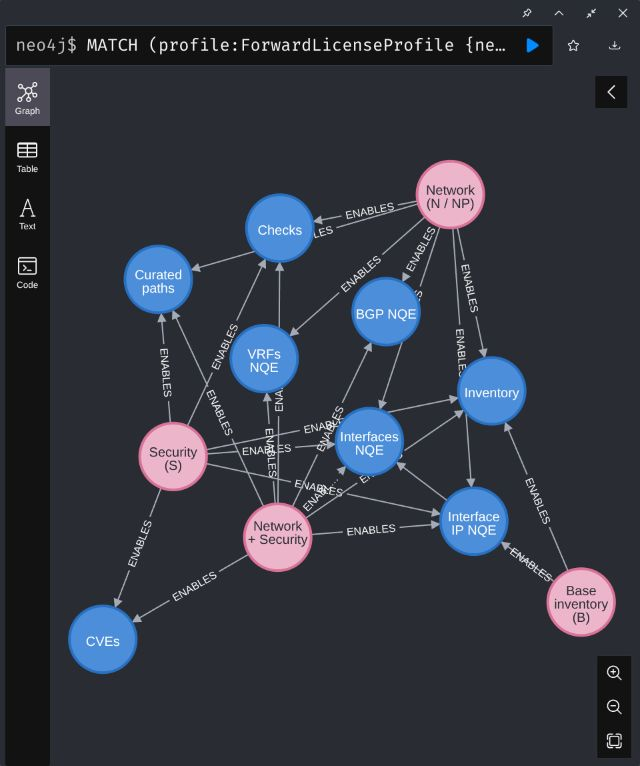

<p align="center">
  
</p>

# Forward Neo4j reference integration

[](https://github.com/forwardnetworks/forward-neo4j/actions/workflows/ci.yml)
[](https://github.com/forwardnetworks/forward-neo4j/releases)

A self-managed Neo4j plugin that publishes selected Forward Networks data as a snapshot-scoped property graph. It uses
supported Forward REST APIs, fixed and versioned NQE contracts, and idempotent Cypher imports. It is a reference
integration—not an export of Forward's internal graph.

## What it includes

- Device inventory and physical topology from the Devices and Topology APIs.
- Four bundled, reviewable NQEs for interfaces, IP assignments, network instances, and BGP neighbors.
- Asynchronous NQE execution through `nqe-executions`, five-second-or-longer polling, and lazy result paging.
- Direct read integrations for Checks, vulnerability analysis, and curated Bulk Path Search.
- Selectable `B`, `N`, `NP`, `S`, `NS`, and `NSP` profiles that fail locally before calling an unavailable feature.
- Snapshot identity, projection version, source SHA-256, and execution provenance on imported graph data.
- Twenty uniqueness constraints, component import jobs, structural validation, and explicit snapshot publication.
- Optional application ownership, criticality, device, flow, selected Check-detail, and CVE-device correlation.
- Protected credential-file support, sanitized connectivity checks, bounded GET retries, and redirect refusal.
- An optional local user service, Docker demo, synthetic dataset, and LAN-access instructions.

## Screenshots

Release screenshots are generated from `demo/synthetic-data.cypher` in a loopback-only Neo4j home whose database
contains only invented records. They never use a tenant graph, tenant identifiers, or Forward credentials.

### Correlated network, application, and security graph



Five invented devices and documentation-only IP space demonstrate physical topology, an operator-defined application,
a curated path observation, one synthetic Check, and `CVE-2099-0001` without representing any customer environment.

### Selectable license and feature catalog



Pink nodes are the selectable Base, Network, Security, and combined profiles. Blue nodes are the imports each profile
enables. The exact bundled projection IDs—`interfaces-v1`, `interface-addresses-v1`, `network-instances-v1`, and
`bgp-neighbors-v1`—remain stored on the synthetic feature nodes and shipped as reviewable NQE source files.

## Quick start

Requirements: Java 21 and Neo4j Community 2026.06.x.

```bash
./gradlew clean test jar
install -d ~/.local/state/forward-neo4j/plugins ~/.config/systemd/user ~/.config/forward-neo4j
install -m 0644 build/libs/forward-neo4j-plugin-0.2.0.jar \
  ~/.local/state/forward-neo4j/plugins/forward-neo4j-plugin.jar
install -m 0644 deploy/neo4j.conf ~/.config/forward-neo4j/neo4j.conf
install -m 0644 deploy/forward-neo4j.service ~/.config/systemd/user/forward-neo4j.service
install -m 0600 /dev/null ~/.config/forward-neo4j/forward.credentials
```

Populate `~/.config/forward-neo4j/forward.credentials` with four lines:

```text
API client ID or username
API client secret or password
Forward HTTPS hostname or base URL
default network ID
```

Then start Neo4j and verify the installed plugin:

```bash
systemctl --user daemon-reload
systemctl --user start forward-neo4j.service
cypher-shell -a bolt://127.0.0.1:7687 -u neo4j \
  'CALL forward.plugin.info() YIELD version RETURN version'
```

See [installation and LAN access](docs/INSTALL.md) for Arch, generic Linux, Docker, authentication, firewall, and TLS
instructions.

## Procedure surface

```cypher
CALL forward.plugin.info();
CALL forward.license.features();
CALL forward.testConnection();
CALL forward.schema.install();
CALL forward.import.snapshot("network-id", "snapshot-id");
CALL forward.import.submit("interfaces-v1", "network-id", "snapshot-id");
CALL forward.import.begin("interfaces-v1", "network-id", "snapshot-id");
CALL forward.import.complete("interfaces-v1", "network-id", "snapshot-id", 100, 100);
CALL forward.import.status("network-id", "snapshot-id");
CALL forward.snapshot.validate("network-id", "snapshot-id", ["interfaces-v1"]);
CALL forward.snapshot.publish("network-id", "snapshot-id");
CALL forward.snapshot.status("network-id", "snapshot-id");
CALL forward.nqe.projections();
CALL forward.nqe.stream("bgp-neighbors-v1", "network-id", "snapshot-id");
CALL forward.checks.stream("network-id", "snapshot-id");
CALL forward.vulnerabilities.stream("network-id", "snapshot-id");
CALL forward.paths.stream($flows, $options, "network-id", "snapshot-id");
```

`forward.testConnection()` makes a real `GET /api/networks` request but returns only sanitized booleans, counts, and
duration. Empty network and snapshot arguments use the configured default network and the newest already-processed
snapshot. The integration deliberately avoids an endpoint that could trigger processing.

## License-aware feature selection

Set `FORWARD_LICENSE_TIER` to the Forward tier the deployment has: `B`, `N`, `NP`, `S`, `NS`, or `NSP`. The default is
the conservative inventory-only `B` profile. `NS` and `NSP` enable every current integration feature. The selector does
not grant or discover a Forward entitlement; it prevents this integration from calling features outside the configured
profile. Forward remains authoritative.

```cypher
CALL forward.license.features()
YIELD configuredLicenseTier, feature, enabled, requiredFacet, description
RETURN * ORDER BY feature;
```

See the [license and feature matrix](docs/LICENSE_PROFILES.md) for the Base, Network, Security, shared-feature, and
Predict boundaries.

## Bundled NQEs

| Projection | Required facet | Source | Graph purpose |
|---|---|---|---|
| `interfaces-v1` | Base | [NQE](src/main/resources/nqe/interfaces-v1.nqe) | Interface properties and operational state |
| `interface-addresses-v1` | Base | [NQE](src/main/resources/nqe/interface-addresses-v1.nqe) | IPv4/IPv6 assignments from modeled interface containers |
| `network-instances-v1` | Network | [NQE](src/main/resources/nqe/network-instances-v1.nqe) | VRF identity and modeled counts |
| `bgp-neighbors-v1` | Network | [NQE](src/main/resources/nqe/bgp-neighbors-v1.nqe) | Directional BGP-neighbor observations and resolved peers |

Only these bundled names can be executed. Arbitrary NQE text and credentials are never accepted as Cypher arguments.
See [NQE contracts and import mappings](docs/NQE.md) for the async lifecycle, stable identities, and full-import commands.

## API allocation

| Need | Forward API | Integration status |
|---|---|---|
| Snapshot context | Network snapshots | implemented |
| Device anchors | Devices | implemented |
| Physical links | Topology | implemented |
| Interfaces, IPs, VRFs, BGP | Async NQE executions | implemented |
| Verification state | Checks | implemented; Network or Security |
| Security findings | Vulnerability APIs | implemented; Security |
| Curated application flows | Bulk Path Search | implemented; Network or Security |

NQE is used for modeled, vendor-neutral structural facts. Specialized APIs remain authoritative for checks, security
findings, and path outcomes. Those results should become snapshot-scoped observation nodes, not permanent topology.

## Documentation

- [Installation, configuration, LAN access, and upgrades](docs/INSTALL.md)
- [License tiers and selectable features](docs/LICENSE_PROFILES.md)
- [NQE sources, async execution, identities, and imports](docs/NQE.md)
- [Checks, vulnerabilities, and curated path imports](docs/DIRECT_APIS.md)
- [Architecture, graph model, API split, and trust boundaries](docs/ARCHITECTURE.md)
- [Production lifecycle, validation, publication, and recovery](docs/PRODUCTION.md)
- [Customer demo runbook](docs/CUSTOMER_DEMO.md)
- [Synthetic demo](demo/README.md)
- [Engineering handoff and roadmap](HANDOFF.md)
- [Security policy](SECURITY.md)
- [Contributing](CONTRIBUTING.md)

## Current boundaries

- The plugin targets self-managed Neo4j. AuraDB needs an external connector using the Neo4j driver.
- Base Devices/Topology uses set-oriented writes in one Neo4j transaction; large NQE and direct-API imports are batched.
- Partial batches remain restartable and cannot advance `currentSnapshotId` until component and structural validation pass.
- The repository includes no tenant data, credentials, or screenshots of a live environment.
