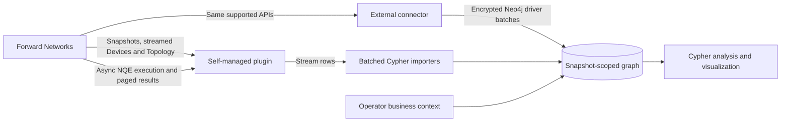
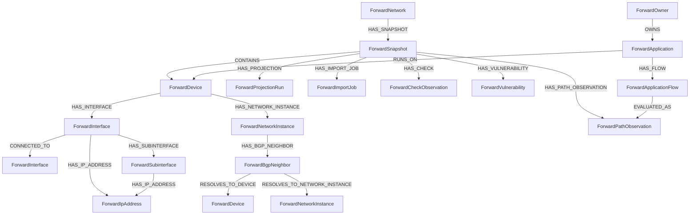

# Architecture

The integration has two deployment adapters: a self-managed Neo4j plugin and a client-side connector for AuraDB or
remote managed Neo4j. Both call supported, read-only Forward data APIs and map their responses to the same temporal
property graph. Forward remains the source of truth; Neo4j is a derived analytical view.

## Graph model

All Forward-derived identities are snapshot-scoped. Stable operator context is network-scoped and relates to devices or
observations with an explicit snapshot identifier. `ForwardNetwork.currentSnapshotId` advances only after structural
validation and explicit publication; it is not a reason to discard historical snapshots.

## Predict snapshots

A Forward Predict snapshot is an ordinary snapshot that describes a state the network was never in. It appears in
the normal snapshot list with `processingTrigger: PREDICT`, a `parentSnapshotId`, and a `changeSetId`. The integration
imports one only when its ID is named explicitly, records `kind = 'PREDICTED'`, and links it to its base snapshot with
`(:ForwardSnapshot)-[:PREDICTED_FROM]->(:ForwardSnapshot)` when the base is already in the graph. A predicted snapshot
never becomes the candidate or current snapshot and publication refuses it, so published history stays a record of
observed state. Comparing a prediction with its base uses the same snapshot-scoped queries as any two snapshots.

## API split

| Domain | Source | Why |
|---|---|---|
| Snapshot selection | Network snapshots API | authoritative lifecycle and temporal identity |
| Device anchors | Devices API | authoritative inventory identity and metadata |
| Physical links | Topology API | explicit modeled interface adjacency |
| Interface/VRF/BGP structure | Fixed async NQEs | compact vendor-neutral extraction contracts |
| Verification | Checks API | preserve check status and policy semantics |
| Security | Vulnerability APIs | preserve finding identity, severity, and details |
| Forwarding behavior | Bulk Path Search | preserve ordered hops and terminal outcome for curated flows |

The local tier selector follows current operation gates: Checks and Paths require Network or Security, vulnerabilities
require Security, and routing-model NQEs require Network. See [license profiles](LICENSE_PROFILES.md).

Checks, vulnerabilities, and paths should be modeled as observations tied to a snapshot. A successful path result is not
a permanent physical edge, and a failed check is not a topology relationship.

## Trust boundaries

- Forward credentials enter through protected local configuration and never through Cypher arguments.
- Forward Authorization headers are never redirected to another origin.
- The plugin logs operational identifiers needed for local troubleshooting; operators must treat Neo4j logs as
  environment-sensitive and keep them out of public issues and releases.
- Public tests, demos, and screenshots use synthetic identifiers and documentation IP ranges only.
- Neo4j connector exposure is independent of Forward API access. The default service binds to loopback; LAN exposure
  requires authentication, explicit connector binding, and subnet-scoped firewall rules.

## Failure semantics

- Snapshot inventory/topology HTTP arrays are incrementally parsed and written in bounded transactions.
- Each NQE submission is at-most-once from the caller's perspective because POST is not retried.
- Result reads are lazy and GET retries are bounded.
- Batched imports may be partially committed. Stable identities make a rerun idempotent.
- Component jobs make partial state explicit. A failed or missing required component blocks publication.
- Publication atomically advances the current pointer; already-published snapshots are immutable through import APIs.
- Retention preview protects current, previous, candidate, and requested history. Deletion requires exact snapshot IDs
  and is limited to integration-owned snapshot labels.
- Scheduled execution remains outside Neo4j under a one-shot service and file lock; no plugin background thread owns
  tenant credentials or import state.
