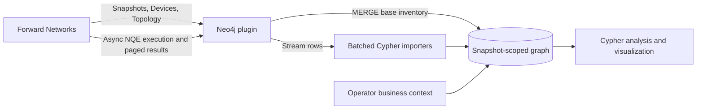
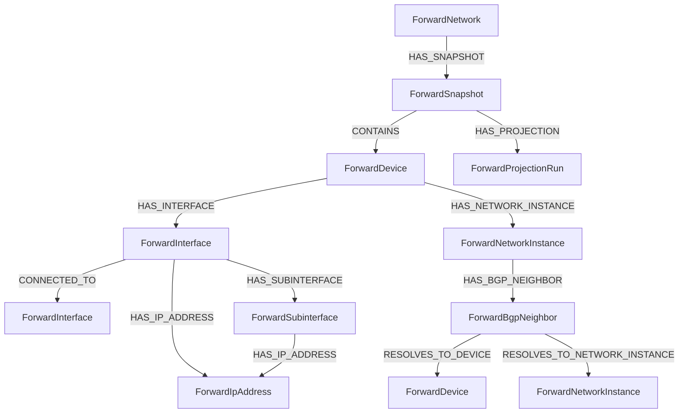

# Architecture

The integration is a self-managed Neo4j plugin. Neo4j procedures call supported, read-only Forward data APIs and map
their responses to a temporal property graph. Forward remains the source of truth; Neo4j is a derived analytical view.

## Graph model

All Forward-derived identities are snapshot-scoped. `ForwardNetwork.currentSnapshotId` is a convenience pointer; it is
not a reason to discard historical snapshots.

## API split

| Domain | Source | Why |
|---|---|---|
| Snapshot selection | Network snapshots API | authoritative lifecycle and temporal identity |
| Device anchors | Devices API | authoritative inventory identity and metadata |
| Physical links | Topology API | explicit modeled interface adjacency |
| Interface/VRF/BGP structure | Fixed async NQEs | compact vendor-neutral extraction contracts |
| Verification | Checks API | preserve check status and policy semantics |
| Security | Vulnerability APIs | preserve finding identity, severity, and details |
| Forwarding behavior | Bulk Path Search | preserve ordered hops and terminal outcome for curated flows |

The local tier selector follows current operation gates: Checks and Paths require Network or Security, vulnerabilities
require Security, and routing-model NQEs require Network. See [license profiles](LICENSE_PROFILES.md).

Checks, vulnerabilities, and paths should be modeled as observations tied to a snapshot. A successful path result is not
a permanent physical edge, and a failed check is not a topology relationship.

## Trust boundaries

- Forward credentials enter through protected local configuration and never through Cypher arguments.
- Forward Authorization headers are never redirected to another origin.
- The plugin logs operational identifiers needed for local troubleshooting; operators must treat Neo4j logs as
  environment-sensitive and keep them out of public issues and releases.
- Public tests, demos, and screenshots use synthetic identifiers and documentation IP ranges only.
- Neo4j connector exposure is independent of Forward API access. The default service binds to loopback; LAN exposure
  requires authentication, explicit connector binding, and subnet-scoped firewall rules.

## Failure semantics

- Snapshot inventory/topology writes currently share one Neo4j transaction.
- Each NQE submission is at-most-once from the caller's perspective because POST is not retried.
- Result reads are lazy and GET retries are bounded.
- Batched imports may be partially committed. Stable identities make a rerun idempotent.
- Publication and retention are operator decisions until an explicit job state machine is implemented.
