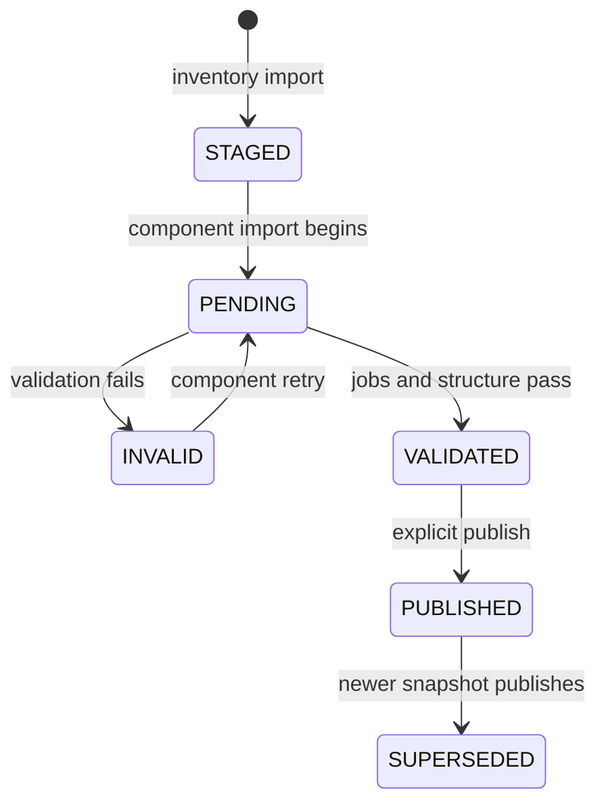

# Production-oriented operation

The plugin treats Neo4j as a derived analytical view. Forward remains authoritative, and a failed or partial import
must never become the graph's advertised current snapshot.

## Snapshot lifecycle



`ForwardNetwork.currentSnapshotId` changes only in `forward.snapshot.publish()`. Import procedures set
`candidateSnapshotId`; they do not expose partially imported data as current.

Every selected component has one deterministic `ForwardImportJob` per network snapshot. Its state is one of
`SUBMITTED`, `IMPORTING`, `VALIDATED`, or `FAILED`, with an attempt number, timestamps, imported row count, optional expected row
count, and a bounded error message. The surrounding snapshot adds `PENDING`, `INVALID`, and `VALIDATED` validation
states plus `STAGED`, `PUBLISHED`, and `SUPERSEDED` publication states.

## Procedures

```cypher
CALL forward.import.submit("interfaces-v1", $networkId, $snapshotId);
CALL forward.import.begin("interfaces-v1", $networkId, $snapshotId);
// Run the matching importer.
CALL forward.import.complete("interfaces-v1", $networkId, $snapshotId, $rowsImported, $expectedRows);

CALL forward.import.status($networkId, $snapshotId);
CALL forward.snapshot.validate($networkId, $snapshotId, $requiredComponents);
CALL forward.snapshot.status($networkId, $snapshotId);
CALL forward.snapshot.publish($networkId, $snapshotId);
CALL forward.snapshot.retention.preview($networkId, 2, 30);
CALL forward.snapshot.prune($networkId, $explicitSnapshotIds);
```

`inventory` is always required by validation. Additional required components are explicit and license-gated. This
keeps a Base deployment honest while allowing Network, Security, or combined deployments to validate only the data
they intentionally imported. Curated paths, selected detail materialization, and operator business context are
optional components rather than hidden publication requirements.

Published snapshots are immutable through these import procedures. Import a newer Forward snapshot instead of
silently modifying the graph behind the current pointer.

## Structural validation

Validation currently fails closed on:

- a missing or non-validated required component;
- a snapshot containing no devices;
- interfaces without a device anchor;
- IP addresses without an interface or subinterface anchor;
- network instances without a device anchor;
- BGP observations without a network-instance anchor; or
- physical links crossing network or snapshot boundaries.

Constraints provide identity integrity. Validation provides relationship and publication integrity. Both are needed.

## Import execution

The supported operator wrapper is [`demo/run-import.sh`](../demo/run-import.sh). It verifies that the requested tier
matches the server selector, installs schema, imports the selected tier's components, records component failures,
validates structure, and publishes only when `--publish` is supplied.

```bash
read -rsp "Neo4j password: " NEO4J_PASSWORD
export NEO4J_PASSWORD
demo/run-import.sh --tier NS

# After reviewing forward.import.status and forward.snapshot.status:
demo/run-import.sh --tier NS --publish
unset NEO4J_PASSWORD
```

Use an explicit `--snapshot` for repeatable demos. Omitting it selects the latest processed, non-archived Forward
snapshot through the read-only API.

Base inventory uses `forward.inventory.devices.stream` and `forward.inventory.topology.stream`. Forward JSON arrays
are parsed incrementally, and the paired Cypher importers commit every 5,000 rows. Only device-name strings are retained
while topology endpoint references are resolved. A malformed or interrupted response fails the run; it is not silently
restarted mid-array. Stable keys make a new run idempotent.

The legacy `forward.import.snapshot()` procedure remains for compatibility and small estates. The supported wrapper
uses the streamed path by default.

## Retention and pruning

Preview first:

```cypher
CALL forward.snapshot.retention.preview($networkId, 2, 30)
YIELD snapshotId, publicationState, protectedSnapshot, eligible, reason
RETURN * ORDER BY eligible DESC, snapshotId;
```

The current, previous, and candidate pointers are always protected. `keepPublished` must be at least two, and the age
window prevents newly staged data from becoming immediately eligible. Pruning never accepts a policy expression: pass
the exact reviewed IDs from the preview.

```cypher
CALL forward.snapshot.prune($networkId, ["reviewed-old-snapshot"]);
```

Prune is capped at 100 snapshots per call, rechecks protected pointers in the write transaction, refuses missing IDs,
and deletes only integration-owned snapshot labels. Network-scoped applications, owners and flows—and customer-owned
labels—are not delete targets.

## Scheduling and metrics

The optional systemd timer runs a one-shot import under `flock`; it does not create background threads inside Neo4j.
It is disabled by default. See [installation](INSTALL.md#optional-scheduled-imports-and-metrics) for a manual staged-run
gate before enabling it.

`forward.metrics.prometheus()` reports durable graph health: network presence, pending candidate state, current device
count and age, snapshot states, and import-job states. `deploy/export-metrics.sh` writes the textfile atomically. It
does not publish an HTTP endpoint or expose Forward credentials.

## Recovery

An importer failure should be followed by `forward.import.fail()`. Fix the cause and rerun `forward.import.begin()`;
the deterministic job increments its attempt and the idempotent MERGE-based importer resumes safely. Never publish by
manually setting `currentSnapshotId`.

Operational logs and local Neo4j data can contain tenant identifiers. Keep them out of public issues, screenshots,
release archives, and Git commits.
